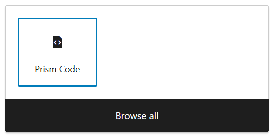
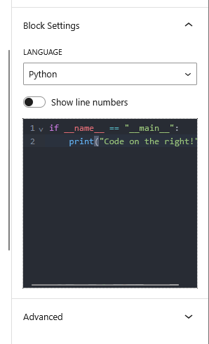
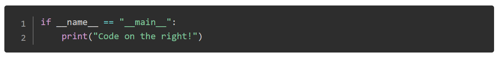

# PrismPress

Version: `1.4.0`

PrismPress is a WordPress plugin that adds a new Gutenberg block for display syntax-highlighted code powered on the front-end by [Prism.js](https://prismjs.com/index.html), and powered in the editor by [CodeMirror](https://codemirror.net/).

## Installation

On Github, download the package from the latest release. This will be called `prismpress.zip`.

You can then upload this file directly to your WordPress installation and activate the plugin.

## How to use

With the plugin installed and activated, edit a post with the Gutenberg editor.

When adding a new block, you can then select the `Prism Code` block:

All content is added and managed via the 'Block settings' menu on the right-hand side and NOT in the block preview itself. This is due to the way Prism.js rewrites the structure of the markup, editing the text within the block isn't reliable so this resolves that issue.

Final result:

## Prism.js information

Prism.js details:
- Version: `1.29.0`
- Theme:
  - Okaidia
- Language support:
  - Markup (HTML + XML + SVG + MathML + SSML + Atom + RSS)
  - CSS
  - C-like
  - Javascript
  - Bash + Shell
  - Docker
  - JSON
  - Markup templating
  - PHP
  - Python
  - YAML
- Prism.js Plugins:
  - Line numbers
  - Show language
  - Toolbar
  - Copy to clipboard
- [Manual download Link for the above configuration](https://prismjs.com/download.html#themes=prism-okaidia&languages=markup+css+clike+javascript+bash+json+markup-templating+php+python&plugins=line-numbers+show-language+toolbar+copy-to-clipboard)
